  

  <a href="https://x.com/nullkern"><b>X / @nullkern</b></a>
  &nbsp;&nbsp;&middot;&nbsp;&nbsp;
  <a href="https://github.com/NullkernDev?tab=repositories"><b>Repositories</b></a>
  &nbsp;&nbsp;&middot;&nbsp;&nbsp;
  <code>/dev/null</code>

 

### About

I'm an AI engineer working in **C++** and **Rust**. For the last two years I've been building with **ChatGPT and the OpenAI API**: prompts, tool calls, pipelines and the glue that turns a model into a product. Now I'm taking that work closer to the metal, where AI tooling gets fast and lean.

Everything I build is public from the first commit.

### Focus

<table>
  <tr>
    <td width="33%" valign="top">
      <b>Low-level AI</b> 
      Fast, dependency-light AI tooling in C++ and Rust. No bloated runtimes, no magic.
    </td>
    <td width="33%" valign="top">
      <b>LLM engineering</b> 
      Two years shipping on top of ChatGPT and the OpenAI API: prompts, tools, pipelines.
    </td>
    <td width="33%" valign="top">
      <b>Open source</b> 
      No private drafts. Every project is public: read it, fork it, break it.
    </td>
  </tr>
</table>

### Stack

